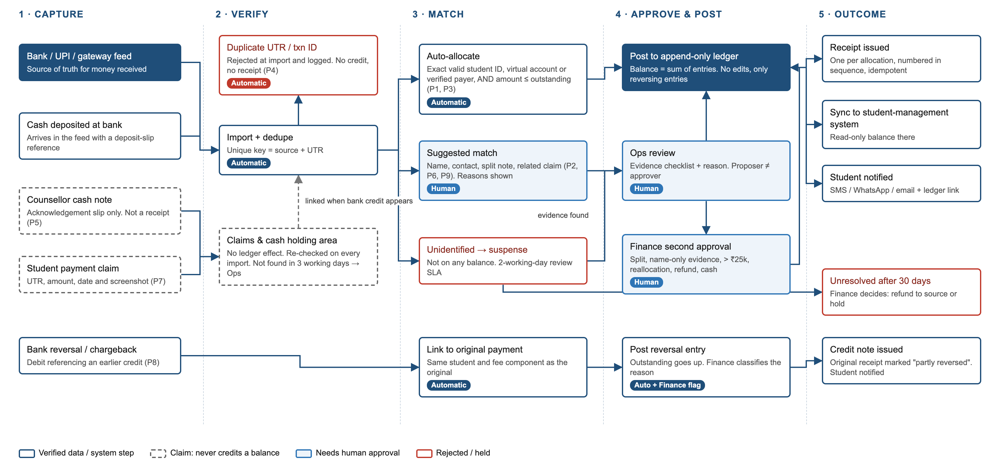
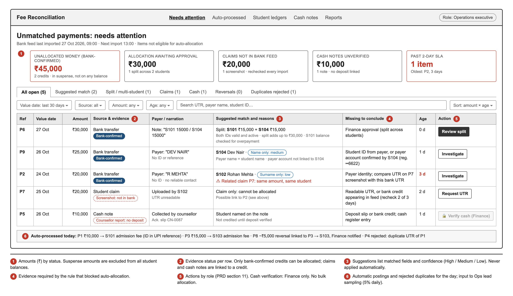
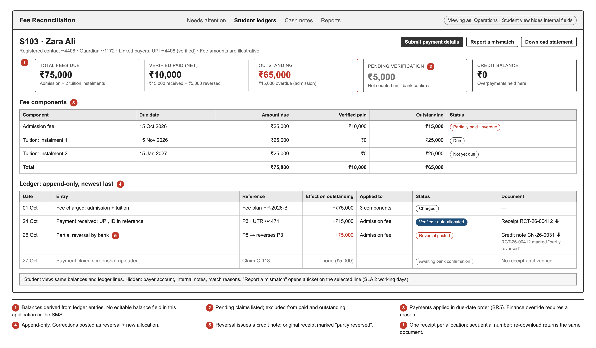
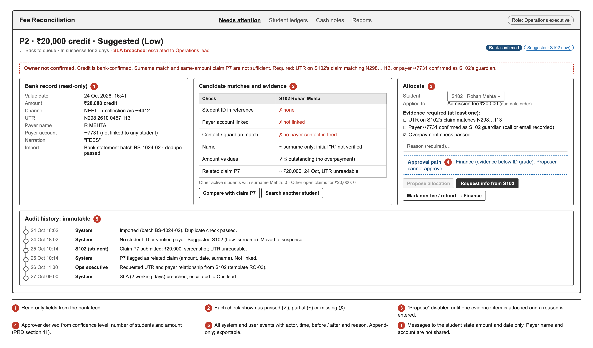

# Verified Fee Reconciliation: Intellipaat PM Assignment

Product Manager hiring assignment by **Kushal Chakrabarty**, October 2026.

The case: a college receives fees by UPI, bank transfer and cash, often from parents or friends rather than the registered student. An Associate PM proposed "Automated Student Fee Matching", which relied on payment screenshots and name matching. This submission reviews that proposal, finds 12 gaps (10 blocking engineering), and rebuilds it as a development-ready feature.

## Contents

| File | What it is |
|---|---|
| [`Kushal_Chakrabarty_PM_Assignment_1_Presentation.pptx`](Kushal_Chakrabarty_PM_Assignment_1_Presentation.pptx) | 10 content slides plus an appendix: gap analysis, workflow, handling of the 9 sample payments, rules, wireframes, engineering handoff, APM feedback and the founder update |
| [`Kushal_Chakrabarty_PM_Assignment_2_PRD.pdf`](Kushal_Chakrabarty_PM_Assignment_2_PRD.pdf) | Full PRD (17 pages): requirements, business rules, permissions, data fields, error states, 14 acceptance criteria and 12 test scenarios |
| [`Kushal_Chakrabarty_PM_Assignment_3_Wireframes/`](Kushal_Chakrabarty_PM_Assignment_3_Wireframes) | Workflow diagram and three annotated screens |

### Wireframes

| | |
|---|---|
|  |  |
| Payment workflow | Screen 1: Unmatched Payment Dashboard |
|  |  |
| Screen 2: Student Fee Ledger | Screen 3: Payment Reconciliation Detail |

## Core product decisions

1. **The bank / UPI / gateway feed is the only proof of payment.** Screenshots and counsellor cash reports are claims, linked once the matching credit arrives.
2. **Receiving money and allocating it are separate steps.** Confirmed money whose owner is unknown waits in a suspense queue with an owner and a deadline.
3. **Allocation is automatic only on an ID-grade identifier** (student ID, virtual account or verified payer account). Name and contact matches are suggestions for a person to approve.
4. **Balances are calculated from an append-only ledger.** No one can edit a balance, and corrections are posted as reversing entries.
5. **Maker-checker on every manual action.** Whoever proposes an allocation cannot approve it, and every action is audited.

On the nine sample records, the system posts ₹25,000 automatically, routes ₹75,000 to human review and credits none of the ₹40,000 that is unverified or duplicated.
